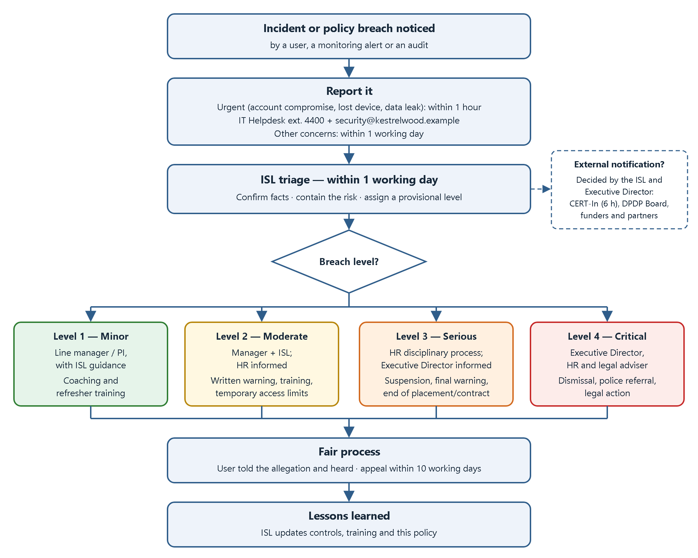
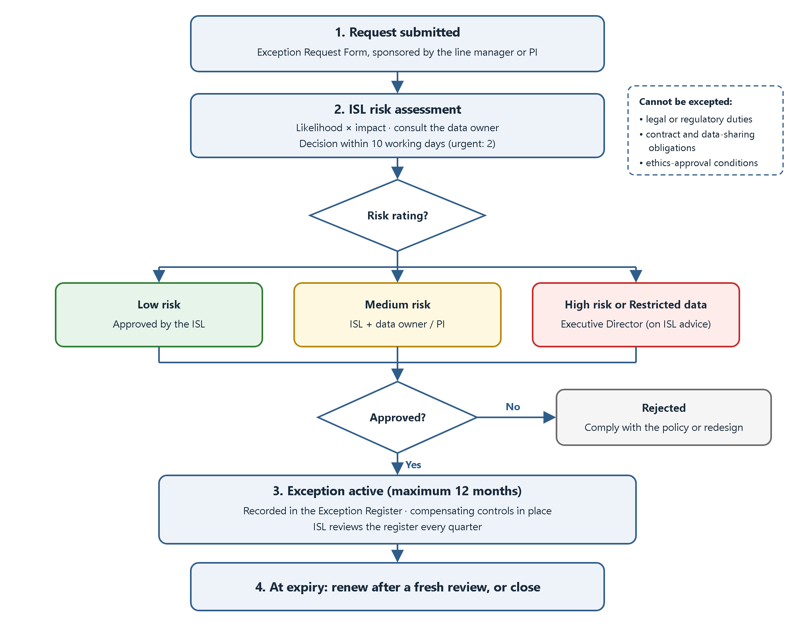

# Kestrelwood Research Institute — Acceptable Use Policy

| Document control | |
|---|---|
| **Document ID** | KRI-ISP-001 |
| **Version** | 1.0 |
| **Status** | Issued |
| **Classification** | Internal |
| **Policy owner** | Information Security Lead |
| **Approved by** | Executive Director |
| **Effective date** | 1 November 2026 |
| **Next review date** | 1 November 2027 |
| **Prepared by** | Arpit Yadav, Intern ID 2415, RedKross Research Foundation |

> **Note:** Kestrelwood Research Institute (KRI) is a fictional organisation created for this assignment. It is a non-profit research institute with about 30 people: researchers, research assistants, interns, visiting collaborators, a small operations team and a two-person IT team. All contact details use the reserved `.example` domain.

**Version history**

| Version | Date | Author | Summary of changes |
|---|---|---|---|
| 1.0 | 25 October 2026 | Arpit Yadav | First issue of the policy |

<!-- pagebreak -->

<!-- WORDTOC -->

<!-- pagebreak -->

## 1. Purpose

This policy sets out the rules for using Kestrelwood Research Institute's (KRI) information, systems, networks and devices. It has four aims:

- to protect research data, research participants' personal data and intellectual property from loss, misuse and unauthorised disclosure;
- to protect the people who use KRI systems by making expectations clear and fair;
- to help KRI meet its legal, contractual, funder and research-ethics obligations;
- to keep KRI systems available and reliable for research.

KRI values open, collaborative research. This policy is not meant to block reasonable work. It sets the minimum standard of behaviour that keeps that work, and the people involved in it, safe.

### 1.1 How to read this policy

| Term | Meaning |
|---|---|
| **must** / **must not** | A mandatory requirement. Not following it is a breach of this policy. |
| **should** / **should not** | Strongly recommended. Do not deviate without a good reason, and be ready to explain it. |
| **may** | Permitted, but not required. |

If you are unsure whether something is allowed, ask the Information Security Lead **before** you act. Asking is always the right choice.

## 2. Scope

### 2.1 People

This policy applies to everyone who is given access to KRI information or systems ("users"), including:

- employees (full-time, part-time and fixed-term);
- interns, students and trainees;
- visiting researchers and research collaborators;
- contractors, consultants and suppliers;
- volunteers and anyone else issued a KRI account.

### 2.2 Information and assets

This policy covers:

- **KRI-owned or leased devices:** laptops, desktops, mobile phones, tablets, servers, and computers attached to laboratory instruments;
- **personal devices** when they are used to access KRI email, files or systems ("bring your own device", or BYOD);
- **KRI networks:** wired, staff Wi-Fi, guest Wi-Fi and remote access (VPN);
- **KRI accounts and services:** email, collaboration and file-storage services, research computing, code repositories and any approved cloud or software-as-a-service tool;
- **KRI information in any form:** digital files, paper records and spoken conversations.

### 2.3 Locations

The policy applies on KRI premises, while working remotely and while travelling.

### 2.4 Relationship to other requirements

This policy sets the baseline. Research-ethics approvals, data-sharing agreements, funder conditions and contracts may impose stricter rules for particular projects. Where they do, **the stricter rule applies**.

## 3. Definitions

| Term | Definition |
|---|---|
| **Asset** | Any information, device, system, account or service owned, leased or managed by KRI. |
| **BYOD** | "Bring your own device": a personally owned device used to access KRI information or services. |
| **Data owner** | The person accountable for a set of information, usually the Principal Investigator (PI) for research data or the head of the relevant function for operational data. |
| **Information Security Lead (ISL)** | The person responsible for KRI's information security programme and the owner of this policy. |
| **Incident** | Any event that has harmed, or could harm, the confidentiality, integrity or availability of KRI information or systems. This includes suspected incidents. |
| **Multi-factor authentication (MFA)** | Sign-in that needs two or more different types of evidence, for example a password plus a code from an authenticator app. |
| **Personal data** | Information about an identified or identifiable living person, including research participants. |
| **Privileged account** | An account with administrative rights to systems, devices or services. |
| **Removable media** | USB drives, external hard drives, memory cards and similar portable storage. |
| **Unapproved service** | Any software, app or online service that is not on KRI's Approved Services List and has not been approved through Section 13. |
| **User** | Anyone within the scope of Section 2.1. |

## 4. Roles and Responsibilities

| Role | Responsibilities |
|---|---|
| **Executive Director** | Approves this policy. Provides resources for information security. Approves high-risk exceptions. Makes the final decision on Level 4 breaches and authorises access to the content of a user's communications (Section 11.4). |
| **Information Security Lead (ISL)** | Owns, maintains and reviews this policy. Provides guidance and awareness training. Receives and coordinates incident reports. Maintains the Exception Register. Oversees security monitoring. |
| **IT Support** | Creates, changes and removes accounts. Configures and patches devices. Implements technical controls such as encryption, MFA and endpoint protection. Provides first-line support. |
| **Line managers and Principal Investigators** | Make sure their team members read and acknowledge this policy. Approve access requests for their team. Tell IT about joiners, movers and leavers on time. Are the first point of escalation for minor breaches. |
| **Data owners** | Classify their information (Section 9). Approve who can access and share it. Make sure handling meets ethics approvals and agreements. |
| **Human Resources (HR)** | Includes policy acknowledgement in onboarding. Tells IT about leavers. Manages the disciplinary process. |
| **All users** | Follow this policy. Complete security training. Protect their accounts, devices and the information they handle. Report incidents and concerns promptly. Ask when unsure. |

## 5. Acceptable Use

### 5.1 General principles

Users **must**:

- use KRI resources mainly for KRI work;
- act lawfully, ethically and professionally;
- access only the information and systems they are authorised to use and need for their role ("least privilege" and "need to know");
- protect information according to its classification (Section 9);
- follow the instructions of IT Support and the ISL on security matters.

### 5.2 Limited personal use

Occasional, brief personal use of KRI devices and networks is permitted, provided it:

- does not interfere with work or with other people's work;
- does not use significant resources, such as large downloads or continuous streaming;
- is not for commercial gain or for running a personal business;
- does not breach any other part of this policy.

Personal files stored on KRI systems are covered by the monitoring notice in Section 11. Users should not keep personal data such as photo backups on KRI storage. Personal files left on KRI systems may be deleted when a user leaves.

### 5.3 Email and messaging

- Users **must** use their KRI email account for KRI business.
- Users **must not** set up automatic forwarding of KRI email to personal accounts.
- Users **must** verify unexpected requests for payment, passwords, data or changes to bank details through a separate, known channel, such as a phone call to a number already on record.
- Users **should** check recipients carefully before sending Confidential or Restricted information.
- Users **must** use only KRI-approved tools for chat, video calls and file sharing.

### 5.4 Internet and cloud services

- KRI information classified as Internal, Confidential or Restricted **must** be stored and processed only in services on the Approved Services List maintained by IT.
- Users who need a new service **must** ask IT before using it with KRI information. IT and the ISL will assess it.
- Users **must not** use free public file-sharing, note-taking or conversion websites for non-public KRI information.

### 5.5 Artificial intelligence (AI) tools

- Users **may** use KRI-approved AI tools, signed in with their KRI account, for Public and Internal information.
- Users **must not** enter Confidential or Restricted information into public or unapproved AI tools. This includes participant data, unpublished results, grant applications, passwords and source code containing secrets.
- Users are responsible for checking AI-generated output for accuracy before relying on it.
- Users **must** follow funder, journal and ethics-committee rules on AI use, including disclosure requirements.

### 5.6 Software, code and research computing

- Software **must** be obtained from trusted sources and installed in line with IT's software rules. Licensed software **must** be used within the terms of its licence.
- Open-source software may be used, provided its licence terms are followed.
- Passwords, API keys and other secrets **must never** be committed to code repositories, public or private.
- Code that contains or processes Confidential or Restricted information **must** be kept in KRI-managed private repositories.
- Shared research computing resources (servers and clusters) **must** be used only for approved KRI projects.

### 5.7 Remote and mobile working

- Users **must** connect to internal KRI systems through the KRI VPN or another approved secure access method.
- Users **should** avoid public Wi-Fi for KRI work unless the VPN is connected.
- Users **must** take care that screens and conversations cannot be overseen or overheard in public places.
- Users **must not** allow family members or other people to use KRI devices.

### 5.8 Social media and public communication

- Users **must not** disclose Confidential or Restricted information, or unpublished research results, on social media or in public forums.
- Users **must not** speak on behalf of KRI unless authorised to do so.
- Personal views posted online should be clearly identified as personal.

### 5.9 Clear desk and clear screen

- Users **must** lock their screen when leaving a device unattended (on Windows, press **Windows + L**). Devices will also lock automatically after 10 minutes of inactivity.
- Confidential and Restricted paper documents **must** be locked away when not in use.
- Printouts **must** be collected from shared printers promptly.

## 6. Prohibited Actions

Users **must not** do any of the following.

### 6.1 Access and security controls

- Access, or attempt to access, any system, account or information without authorisation.
- Share their password or MFA codes, or let anyone else use their account.
- Use another person's account or credentials, or impersonate another person.
- Disable, bypass or tamper with security controls, such as endpoint protection, firewalls, encryption, logging, device management or software updates.
- Connect unauthorised network equipment, such as personal routers or wireless access points, to KRI networks.
- Run security testing tools (for example port scanners, password crackers, packet sniffers or exploit frameworks) against KRI systems or networks without prior written authorisation from the ISL that defines the scope of the test.

### 6.2 Information and data

- Store, send or copy Confidential or Restricted information to unapproved services, personal email accounts or personal devices that do not meet Section 8.2.
- Share information beyond what a data-sharing agreement, participant consent or ethics approval permits.
- Attempt to re-identify anonymised or pseudonymised research participants.
- Delete, alter or fabricate research data or records in order to mislead.

### 6.3 Unlawful or harmful content and conduct

- Create, access, store or send material that is illegal, sexually explicit, discriminatory, harassing, defamatory or threatening.
- Harass, bully or intimidate anyone using KRI systems.
- Infringe copyright or licences, for example by using pirated software, media or unlicensed datasets.

### 6.4 Misuse of resources

- Use KRI resources for personal commercial activity, political campaigning or gambling.
- Mine cryptocurrency.
- Send spam, chain letters or unsolicited bulk messages.
- Knowingly introduce malware, or run untrusted code outside an approved isolated environment.
- Deliberately disrupt or overload shared systems or networks.

### 6.5 Concealment

- Use anonymising tools or unapproved VPNs to evade KRI security controls.
- Conceal, or deliberately delay reporting, a known incident or breach of this policy.

> **Research activities:** Some legitimate research may require activities listed above, for example analysing malware or studying harmful online content. Such work needs an approved exception (Section 13) and ethics approval where relevant before it starts, and it must take place in an isolated environment approved by the ISL.

## 7. Account Responsibilities

### 7.1 Individual accounts

- Each user is given a unique account and is accountable for all activity carried out with it.
- Shared or generic accounts are allowed only where technically unavoidable. They need ISL approval and a named owner.

### 7.2 Passwords and passphrases

Users **must**:

- use passwords or passphrases of at least **14 characters**, for example three or four random words;
- use a unique password for each KRI account and never reuse KRI passwords on other websites;
- store passwords only in the KRI-approved password manager, never in plain-text files, spreadsheets, scripts or shared documents;
- change a password immediately if they suspect it has been exposed, and report it (Section 10).

KRI does not force regular password changes. Passwords are changed when there is a reason to believe they may be compromised. This follows current NIST guidance.

### 7.3 Multi-factor authentication (MFA)

- MFA **must** be enabled for email, remote access, cloud services and all privileged accounts.
- Users **should** use an authenticator app or a hardware security key. SMS codes are used only where no other option is available.
- Users **must never** approve an MFA prompt they did not start. An unexpected prompt can mean someone else has the password, so it **must** be reported immediately.

### 7.4 Privileged accounts

- Administrators **must** use a separate privileged account for administrative tasks only, never for email or web browsing.
- Privileged access is granted only with ISL approval and is reviewed every quarter.

### 7.5 Joiners, movers and leavers

- Line managers and PIs **must** review and confirm their team's access every six months.
- When a user changes role, access **must** be updated within five working days.
- When a user leaves, their accounts **must** be disabled on their last working day, or immediately if the departure is for cause. The user must return all KRI devices, and their KRI information must be handed over to their line manager or PI.

### 7.6 Service accounts and API keys

- Credentials for service accounts and API keys **must** be stored in the KRI-approved secrets vault.
- Any key that has been exposed, for example committed to a repository, **must** be revoked and replaced at once and reported to the ISL.

## 8. Device Responsibilities

### 8.1 KRI-owned devices

KRI-owned devices are managed by IT. Users **must**:

- keep full-disk encryption, endpoint protection and device management enabled;
- install security updates promptly and not postpone them for more than **7 days**;
- keep automatic screen lock enabled (10 minutes or less);
- install only approved software;
- keep devices physically secure and never leave them unattended in public places or in vehicles;
- return all devices and accessories when leaving KRI.

### 8.2 Personal devices (BYOD)

Personal devices may be used to access KRI email and approved collaboration tools if they meet these minimum requirements:

- the operating system is still supported by its vendor and receives security updates;
- a PIN, password or biometric screen lock is enabled;
- device storage is encrypted (the default on current smartphones);
- the device is not "jailbroken" or "rooted";
- KRI apps are installed and managed through KRI's app-protection service where IT requires it.

Restricted information **must not** be stored on personal devices. If a personal device is lost, or its owner leaves KRI, IT may remove KRI data and apps from it. IT will not access or delete the user's personal data.

### 8.3 Lost or stolen devices

Users **must** report a lost or stolen device to IT immediately, and **no later than 1 hour** after noticing. This applies to both KRI-owned devices and personal devices with KRI access. IT will lock or wipe the device remotely. For theft, the user should also make a police report and give IT the reference number.

### 8.4 Removable media

- Removable media should be avoided. Use approved file-sharing services instead.
- Confidential information may be stored only on KRI-issued encrypted USB drives.
- Restricted information **must not** be stored on removable media without written ISL approval.
- Users **must never** connect an unknown USB device, such as one found in a car park. Hand it to IT.

### 8.5 Travel

- Keep devices with you while travelling, never in checked luggage.
- Speak to the ISL before taking Restricted information abroad, because some countries allow border officials to inspect devices.

### 8.6 Disposal

All KRI devices and storage media **must** be returned to IT for secure erasure or destruction in line with NIST SP 800-88. Users must not dispose of, sell or give away KRI equipment themselves.

## 9. Data Handling

### 9.1 Information classification

All KRI information falls into one of four classification levels. The data owner sets the classification.

| Level | Description | Examples | Minimum handling rules |
|---|---|---|---|
| **Public** | Approved for public release. No harm if disclosed. | Published papers, website content, public datasets, press releases. | No restrictions once approved for release. Check accuracy before publishing. |
| **Internal** | For KRI use. Limited harm if disclosed. | Internal procedures, meeting notes, project plans, staff directory. | Store only on approved KRI services. Share within KRI as needed. Share externally only for a business reason. |
| **Confidential** | Significant harm to KRI, partners or individuals if disclosed. | Unpublished research results, grant applications, contracts, financial records, HR records, partner data under a non-disclosure agreement. | Approved storage with access limited to named people. Encrypt when sent outside KRI and on portable devices. Label documents "Confidential". Never enter into public AI tools. |
| **Restricted** | Severe harm or legal breach if disclosed. Subject to strict legal or ethical controls. | Identifiable research participant data; health, biometric or genetic data; passwords and encryption keys; data under strict data-sharing agreements; unpatched vulnerability details. | Designated secure storage only (the KRI Restricted Research Enclave). Access approved by the data owner, protected by MFA and logged. Encrypt at rest and in transit. Not on personal devices. Not on removable media without ISL approval. Use the minimum data necessary and de-identify where possible. |

- Unlabelled information **must** be treated as **Internal** until it is classified.
- If you are unsure between two levels, use the **higher** one.

### 9.2 Personal data and research participants

Users handling personal data **must**:

- collect only the personal data needed for the approved purpose;
- use it only for the purpose described in the participant consent and ethics approval;
- comply with applicable data-protection law, including India's Digital Personal Data Protection Act, 2023, and the EU General Data Protection Regulation (GDPR) where it applies;
- pseudonymise data as early as possible, and store the linking key separately from the research data, with tighter access;
- keep data no longer than the retention period set in the project's data management plan.

### 9.3 Sharing and transfer

- Information **must** be shared using approved methods, such as KRI file sharing with named recipients and expiring links. Personal email and messaging apps must not be used.
- Before sending research data outside KRI, users **must** check that a data-sharing agreement or contract allows it.
- Sending Restricted information outside KRI, including to other countries, needs approval from the data owner and the ISL.

### 9.4 Storage and backup

- Work information **must** be saved on approved KRI storage, which is backed up, and not only on a device's local disk.
- Users should avoid making unnecessary copies of Confidential or Restricted information.

### 9.5 Retention and disposal

- Information is kept only as long as required by KRI's records retention schedule, funder conditions or ethics approval.
- Paper containing Internal, Confidential or Restricted information **must** be disposed of in confidential waste bins or with a cross-cut shredder.
- Electronic information **must** be deleted using IT's approved procedures. Devices and media are disposed of through IT (Section 8.6).

## 10. Reporting Incidents and Concerns

### 10.1 What to report

Users **must** report any actual or suspected incident or policy breach, including:

- phishing emails, messages or calls, especially if you clicked a link, opened an attachment or entered a password;
- MFA prompts you did not request;
- lost or stolen devices, ID badges or removable media;
- signs of malware, such as unexpected pop-ups, slowness, or files being encrypted or renamed;
- information sent to the wrong person or shared too widely;
- unauthorised access to accounts, systems or premises;
- security weaknesses you notice;
- breaches of this policy by anyone.

### 10.2 How and when to report

| Situation | When to report | How to report |
|---|---|---|
| Suspected account compromise, lost or stolen device, malware, or a leak of Confidential or Restricted information | **Immediately, and within 1 hour** | Phone the IT Helpdesk on **extension 4400** (out of hours: the on-call number on the intranet) **and** email **security@kestrelwood.example** |
| Phishing email (not clicked) | As soon as possible | Use the **Report Phishing** button in your email client |
| Other concerns or policy breaches | **Within 1 working day** | Email **security@kestrelwood.example** or tell your line manager |

### 10.3 What to do while waiting for help

**Do:**

- disconnect the device from the network (Wi-Fi off or cable out) if you suspect malware, but **do not** switch it off;
- write down what happened, when, and what you saw or clicked;
- follow the instructions of IT and the ISL.

**Do not:**

- delete suspicious emails or files, because they may be needed as evidence;
- try to investigate or "fix" the problem yourself;
- contact the suspected attacker;
- discuss the incident outside KRI unless authorised.

### 10.4 Reporting without blame

KRI wants people to report problems early. **A good-faith report, including a report of your own mistake, will not on its own lead to disciplinary action.** Deliberately hiding or delaying a report is a breach of this policy (Section 6.5).

### 10.5 What happens next

1. The ISL triages the report, contains the risk (for example, by resetting passwords or isolating a device) and investigates.
2. The ISL informs the affected data owners and, for serious incidents, the Executive Director.
3. The ISL and the Executive Director decide whether KRI must notify anyone outside the organisation. This may include CERT-In, which requires certain cyber incidents to be reported within 6 hours; the Data Protection Board of India and affected individuals under the DPDP Act, 2023; and funders or partners under their contracts.
4. After the incident, the ISL records lessons learned and updates controls, training or this policy where needed.

Figure 1 shows the reporting and escalation process.

*Figure 1 — Incident reporting and breach escalation process*

## 11. Monitoring Notice

**Please read this section carefully. It explains how KRI monitors the use of its systems.**

### 11.1 Why KRI monitors

KRI monitors its systems and networks to:

- detect and respond to security threats;
- protect KRI information and people;
- check compliance with this policy and the law;
- keep systems running reliably;
- investigate incidents and suspected misconduct.

### 11.2 What may be monitored

- Network activity records, such as connections made, data volumes and websites visited (DNS and web-filter logs).
- Email security records, such as sender, recipient, subject line and attachment scanning results.
- Sign-in and authentication records.
- Endpoint security alerts and device health information on KRI-owned devices.
- Audit logs of cloud services, and access logs for Confidential and Restricted storage.
- Building access-card records.

### 11.3 What KRI will not do

- Record keystrokes, or secretly activate cameras or microphones.
- Routinely read the content of users' emails, messages or files.
- Monitor personal devices beyond the KRI apps and KRI data on them.

### 11.4 Access to content

Routine monitoring is automated and uses activity records, not message content. KRI will look at the content of a specific user's email, messages or files only:

- to investigate a security incident, suspected policy breach or misconduct;
- to meet a legal obligation; or
- for genuine business continuity, for example retrieving a work file while a user is unexpectedly absent.

Such access needs **written approval from the Executive Director, with HR informed**. It must be limited to what is necessary and proportionate, and it will be logged. The user will be told about it, unless telling them would harm an investigation or break the law.

### 11.5 Privacy

Users should not expect privacy for content created, stored or sent using KRI systems, beyond what the law provides. This includes personal use. KRI carries out monitoring lawfully, fairly and proportionately, in line with the Information Technology Act, 2000 and the Digital Personal Data Protection Act, 2023.

### 11.6 Log retention and access

Security logs are kept for **12 months**, or longer where the law or an ongoing investigation requires it, and are then deleted. Only the ISL and authorised IT staff can access them.

### 11.7 Sign-in notice

KRI systems display a short notice at sign-in that use is subject to this policy and to monitoring. Continuing to sign in means you accept those conditions.

## 12. Compliance, Consequences and Escalation

### 12.1 Principles

KRI handles breaches of this policy fairly, consistently and proportionately. When deciding the outcome, KRI considers:

- whether the breach was accidental, careless or deliberate;
- the actual and potential impact;
- whether the user reported it themselves;
- any previous breaches.

### 12.2 Breach levels

| Level | Description and examples | Handled by | Possible outcomes |
|---|---|---|---|
| **Level 1 — Minor** | Unintentional, low-impact breach. *Examples: leaving a screen unlocked; using an unapproved tool for Public information.* | Line manager or PI, with ISL guidance | Informal discussion, coaching, refresher training |
| **Level 2 — Moderate** | Repeated minor breaches, or a careless breach with moderate impact. *Examples: sending a Confidential file to the wrong person; postponing updates repeatedly; auto-forwarding KRI email.* | Line manager and ISL; HR informed | Written warning, mandatory training, temporary access restrictions |
| **Level 3 — Serious** | Deliberate breach, or a careless breach with serious impact. *Examples: sharing a password; bypassing security controls; storing Restricted data on a personal cloud account; not reporting a known incident.* | HR disciplinary process; ISL; Executive Director informed | Suspension of access, formal disciplinary action, final warning; for interns and contractors, review or end of the placement or contract |
| **Level 4 — Critical** | Malicious or criminal conduct, or gross misconduct. *Examples: data theft; sabotage; unauthorised hacking; harassment; illegal content.* | Executive Director, HR and legal adviser | Immediate removal of access, dismissal or end of contract or placement, referral to law enforcement, legal action |

### 12.3 Escalation process

1. **Identification.** A possible breach is identified through a report, a monitoring alert or an audit.
2. **Triage (within 1 working day).** The ISL confirms the facts, contains the risk (for example, by suspending an account) and assigns a provisional level.
3. **Level 1.** The line manager or PI handles it, and the ISL records it.
4. **Level 2.** The line manager and ISL handle it together. HR is informed and a written record is kept.
5. **Levels 3 and 4.** The ISL escalates to HR and the Executive Director within 1 working day. The formal disciplinary process is followed, with legal advice where needed.
6. **Fair process.** The user is told what is alleged and given the opportunity to respond. They may appeal to the Executive Director within **10 working days**. If the Executive Director was involved in the decision, the appeal goes to the Board of Trustees.
7. **Learning.** The ISL reviews whether controls, training or this policy need to change.

Some breaches may also be criminal offences, for example under the Information Technology Act, 2000. KRI may report these to the authorities. Contractors and suppliers are also bound by the terms of their contracts.

## 13. Exception Process

### 13.1 When an exception may be requested

An exception may be requested when a genuine business or research need cannot be met while following this policy. Examples include analysing malware for a research project, or operating a laboratory instrument whose computer cannot receive updates.

### 13.2 What cannot be excepted

Exceptions cannot be granted for:

- requirements set by law or regulation;
- obligations in contracts or data-sharing agreements;
- conditions of an ethics approval.

### 13.3 How to request an exception

1. Complete the Exception Request Form (Appendix B). The form covers what is needed, why, for how long, what information is involved and what compensating controls are proposed.
2. Ask your line manager or PI to sponsor the request.
3. Submit it to the ISL at **security@kestrelwood.example**.

### 13.4 Assessment and approval

The ISL assesses the risk, considering its likelihood and impact, and consults the data owner. A decision is given within **10 working days**, or within **2 working days** for urgent requests.

| Risk rating | Approval needed |
|---|---|
| Low | ISL |
| Medium | ISL and the data owner or PI |
| High, or any exception involving Restricted information | Executive Director, on the ISL's recommendation |

### 13.5 Conditions

- Every exception is time-limited, to a maximum of **12 months**. It may be renewed after a fresh review.
- Approved compensating controls **must** be put in place and maintained.
- All exceptions are recorded in the **Exception Register**, which the ISL reviews every quarter.
- An exception lapses automatically when it expires.
- Operating outside this policy without an approved exception is a breach.

Figure 2 shows the exception process.

*Figure 2 — Exception request and approval process*

## 14. Policy Review and Maintenance

- The ISL reviews this policy **at least once a year**. The next scheduled review is due by **1 November 2027**.
- An earlier review is triggered by:
    - a significant security incident;
    - a change in law or regulation;
    - the adoption of major new technology, such as a new AI or cloud platform;
    - a significant organisational change;
    - audit findings.
- Reviews include consultation with PIs, HR and a sample of users. Changes are approved by the Executive Director and recorded in the version history.
- Users are told about changes. Material changes require users to acknowledge the policy again.

## 15. Acknowledgement

All users must read and acknowledge this policy before they receive access to KRI systems, and again every year. Acknowledgement is recorded electronically or on paper, using the form in the `forms/` folder of this repository.

> *I confirm that I have read, understood and agree to follow the Kestrelwood Research Institute Acceptable Use Policy (KRI-ISP-001). I understand that KRI monitors the use of its systems as described in Section 11, and that breaches may lead to the consequences described in Section 12.*

| Name | Role | Signature | Date |
|---|---|---|---|
| | | | |

## 16. Related Documents

The following documents form part of KRI's wider policy framework. They are referred to here but are outside the scope of this document:

- KRI Information Security Policy
- KRI Data Protection and Research Data Management Policy
- KRI Incident Response Plan
- KRI Approved Services List
- KRI Records Retention Schedule

<!-- pagebreak -->

## Appendix A — Quick Reference

| Do ✔ | Don't ✘ |
|---|---|
| Lock your screen when you step away (Windows + L) | Share your password or approve MFA prompts you didn't start |
| Use a long, unique passphrase and the password manager | Reuse your KRI password on other websites |
| Keep devices updated (within 7 days) | Turn off antivirus, encryption or updates |
| Store work files on approved KRI storage | Use personal email or free file-sharing sites for KRI data |
| Check the classification before sharing information | Put Confidential or Restricted data into public AI tools |
| Report phishing, lost devices and mistakes at once | Plug in unknown USB drives |
| Ask the ISL when unsure | Hide or delay reporting an incident |

**Report incidents to:** IT Helpdesk, extension 4400 · security@kestrelwood.example

## Appendix B — Exception Request Form (Summary)

The full form is in `forms/exception-request-form.md`. Each request records:

1. The requester's name, role and team, and the sponsoring line manager or PI.
2. The policy section(s) that cannot be met.
3. The business or research need, and why compliance is not possible.
4. The systems and information involved, with their classification levels.
5. The proposed compensating controls.
6. The requested start and end dates (maximum 12 months).
7. The ISL's risk assessment (likelihood, impact, rating).
8. The decision, approver, date and conditions.

## References

1. International Organization for Standardization. (2022). *ISO/IEC 27001:2022 Information security, cybersecurity and privacy protection — Information security management systems — Requirements*; and *ISO/IEC 27002:2022 Information security controls*. Control 5.10, "Acceptable use of information and other associated assets".
2. National Institute of Standards and Technology. (2020). *SP 800-53 Rev. 5: Security and Privacy Controls for Information Systems and Organizations*. Controls PL-4 (Rules of Behavior), AC-8 (System Use Notification), PS-6 (Access Agreements), PS-8 (Personnel Sanctions) and IR-6 (Incident Reporting).
3. National Institute of Standards and Technology. (2025). *SP 800-63B-4: Digital Identity Guidelines — Authentication and Authenticator Management*.
4. National Institute of Standards and Technology. (2025). *SP 800-88 Rev. 2: Guidelines for Media Sanitization*.
5. National Institute of Standards and Technology. (2025). *SP 800-61 Rev. 3: Incident Response Recommendations and Considerations for Cybersecurity Risk Management*.
6. Center for Internet Security. (2024). *CIS Critical Security Controls, Version 8.1*.
7. SANS Institute. *Information Security Policy Templates: Acceptable Use Policy*.
8. Government of India. *Information Technology Act, 2000*; and *Digital Personal Data Protection Act, 2023*.
9. CERT-In. (2022). *Directions under sub-section (6) of section 70B of the Information Technology Act, 2000* (28 April 2022).
